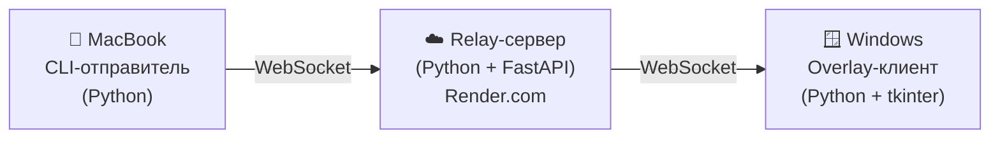

# 📨 Система отправки сообщений Mac → Windows через интернет

## Описание

Программа для отправки текстовых сообщений с MacBook (Компьютер A) на Windows (Компьютер B) через интернет. Сообщения отображаются на Windows как плавающий текст в правом нижнем углу экрана на 2 секунды — **без окна, только текст**.

## Архитектура



Три компонента:

| Компонент | Платформа | Технологии | Назначение |
|-----------|-----------|------------|------------|
| **Relay-сервер** | Облако (Render) | Python, FastAPI, WebSocket | Пересылка сообщений между клиентами |
| **Sender (отправитель)** | macOS | Python, `websockets` | CLI для отправки сообщений |
| **Receiver (получатель)** | Windows | Python, `websockets`, `tkinter` | Получение и показ overlay-текста |

---

## Предлагаемые изменения

### 1. Relay-сервер (`server/`)

#### [NEW] `server/main.py`

Минималистичный WebSocket-сервер на FastAPI:

```python
from fastapi import FastAPI, WebSocket, WebSocketDisconnect
import asyncio

app = FastAPI()

# Хранилище подключённых получателей
receivers: list[WebSocket] = []

@app.websocket("/ws/send")
async def sender_endpoint(websocket: WebSocket):
    """Эндпоинт для отправителя — принимает текст и рассылает получателям."""
    await websocket.accept()
    try:
        while True:
            message = await websocket.receive_text()
            # Рассылка всем подключённым получателям
            disconnected = []
            for receiver in receivers:
                try:
                    await receiver.send_text(message)
                except:
                    disconnected.append(receiver)
            for r in disconnected:
                receivers.remove(r)
    except WebSocketDisconnect:
        pass

@app.websocket("/ws/receive")
async def receiver_endpoint(websocket: WebSocket):
    """Эндпоинт для получателя — держит соединение и пересылает сообщения."""
    await websocket.accept()
    receivers.append(websocket)
    try:
        while True:
            await websocket.receive_text()  # keepalive
    except WebSocketDisconnect:
        receivers.remove(websocket)
```

#### [NEW] `server/requirements.txt`

```
fastapi==0.115.0
uvicorn[standard]==0.30.0
websockets==13.0
```

#### [NEW] `server/Procfile`

```
web: uvicorn main:app --host 0.0.0.0 --port $PORT
```

> [!NOTE]
> Render автоматически использует `Procfile` для запуска сервера. Переменная `$PORT` подставляется Render'ом.

---

### 2. Sender — отправитель для macOS (`sender/`)

#### [NEW] `sender/send.py`

CLI-скрипт: запускаешь, пишешь сообщение, нажимаешь Enter — оно улетает на Windows.

```python
import asyncio
import websockets
import sys

SERVER_URL = "wss://YOUR-APP.onrender.com/ws/send"

async def main():
    print("📨 Подключение к серверу...")
    async with websockets.connect(SERVER_URL) as ws:
        print("✅ Подключено! Пиши сообщение и жми Enter:")
        while True:
            message = await asyncio.get_event_loop().run_in_executor(
                None, input, "> "
            )
            if message.strip():
                await ws.send(message)
                print(f"   → Отправлено: {message}")

if __name__ == "__main__":
    asyncio.run(main())
```

#### [NEW] `sender/requirements.txt`

```
websockets==13.0
```

---

### 3. Receiver — получатель для Windows (`receiver/`)

#### [NEW] `receiver/receive.py`

Ключевой компонент — отображает текст как прозрачный overlay поверх всех окон:

```python
import asyncio
import websockets
import tkinter as tk
import threading
import queue

SERVER_URL = "wss://YOUR-APP.onrender.com/ws/receive"

class OverlayNotification:
    """Прозрачное overlay-окно для показа текста в правом нижнем углу."""
    
    def __init__(self):
        self.msg_queue = queue.Queue()
        self.root = tk.Tk()
        self.root.withdraw()  # Скрываем главное окно
        self._setup_overlay()
    
    def _setup_overlay(self):
        self.overlay = tk.Toplevel(self.root)
        self.overlay.overrideredirect(True)           # Без рамки окна
        self.overlay.attributes('-topmost', True)      # Поверх всех окон
        self.overlay.attributes('-alpha', 0.0)         # Начинаем невидимым
        
        # Прозрачный фон (Windows-специфичная фича)
        bg_color = '#010101'
        self.overlay.configure(bg=bg_color)
        self.overlay.attributes('-transparentcolor', bg_color)
        
        # Текстовая метка
        self.label = tk.Label(
            self.overlay,
            text="",
            font=("Segoe UI", 14),
            fg="white",
            bg=bg_color,
            wraplength=400
        )
        self.label.pack(padx=10, pady=5)
        
        self.overlay.withdraw()  # Скрываем до первого сообщения
    
    def show_message(self, text, duration=2000):
        """Показать сообщение на duration миллисекунд."""
        self.label.config(text=text)
        self.overlay.update_idletasks()
        
        # Позиционирование в правый нижний угол
        screen_w = self.root.winfo_screenwidth()
        screen_h = self.root.winfo_screenheight()
        win_w = self.label.winfo_reqwidth() + 20
        win_h = self.label.winfo_reqheight() + 10
        x = screen_w - win_w - 20
        y = screen_h - win_h - 60  # выше панели задач
        
        self.overlay.geometry(f"+{x}+{y}")
        self.overlay.deiconify()
        self.overlay.attributes('-alpha', 0.9)
        
        # Скрыть через duration мс
        self.overlay.after(duration, self._hide)
    
    def _hide(self):
        self.overlay.attributes('-alpha', 0.0)
        self.overlay.withdraw()
    
    def check_queue(self):
        """Проверяем очередь сообщений из WebSocket-потока."""
        try:
            while True:
                msg = self.msg_queue.get_nowait()
                self.show_message(msg)
        except queue.Empty:
            pass
        self.root.after(100, self.check_queue)
    
    def run(self):
        self.root.after(100, self.check_queue)
        self.root.mainloop()


async def websocket_listener(msg_queue):
    """Подключаемся к серверу и слушаем сообщения."""
    while True:
        try:
            async with websockets.connect(SERVER_URL) as ws:
                print("✅ Подключено к серверу. Ожидаю сообщений...")
                async for message in ws:
                    print(f"📩 Получено: {message}")
                    msg_queue.put(message)
        except Exception as e:
            print(f"⚠️ Потеря соединения: {e}. Переподключение через 5 сек...")
            await asyncio.sleep(5)


def start_ws_thread(msg_queue):
    """Запуск WebSocket-клиента в отдельном потоке."""
    loop = asyncio.new_event_loop()
    asyncio.set_event_loop(loop)
    loop.run_until_complete(websocket_listener(msg_queue))


if __name__ == "__main__":
    overlay = OverlayNotification()
    
    # WebSocket в отдельном потоке (tkinter требует главный поток)
    ws_thread = threading.Thread(
        target=start_ws_thread,
        args=(overlay.msg_queue,),
        daemon=True
    )
    ws_thread.start()
    
    overlay.run()
```

#### [NEW] `receiver/requirements.txt`

```
websockets==13.0
```

> [!IMPORTANT]
> `tkinter` идёт в комплекте с Python на Windows. Дополнительная установка не нужна.

---

## Структура проекта

```
test-message/
├── server/                  # Relay-сервер (деплоится на Render)
│   ├── main.py
│   ├── requirements.txt
│   └── Procfile
├── sender/                  # CLI-клиент для macOS
│   ├── send.py
│   └── requirements.txt
├── receiver/                # Overlay-клиент для Windows
│   ├── receive.py
│   └── requirements.txt
└── README.md                # Инструкция по установке и использованию
```

---

## Деплой на Render

> [!NOTE]
> Render.com — бесплатный облачный хостинг. Сервер будет доступен по адресу `wss://your-app.onrender.com`.

Шаги:
1. Создать аккаунт на [render.com](https://render.com)
2. Создать **Web Service** → подключить GitHub-репозиторий
3. Настройки:
   - **Root Directory**: `server`
   - **Build Command**: `pip install -r requirements.txt`
   - **Start Command**: берётся из `Procfile`
   - **Instance Type**: Free
4. После деплоя получишь URL вида `https://your-app.onrender.com`
5. Заменить `YOUR-APP.onrender.com` в `sender/send.py` и `receiver/receive.py` на реальный URL

---

## User Review Required

> [!IMPORTANT]
> **URL сервера**: После деплоя на Render нужно будет вставить реальный URL сервера в файлы `send.py` и `receive.py`. Я могу сделать это через переменную окружения или конфиг-файл — как предпочитаешь?

> [!WARNING]
> **Бесплатный Render**: Сервер на бесплатном тарифе «засыпает» после 15 минут без трафика. Первое подключение после сна занимает ~30 секунд. Для постоянного использования можно перейти на платный тариф ($7/мес) или использовать cron-пинг.

---

## Открытые вопросы

> [!IMPORTANT]
> 1. **Безопасность**: Сейчас любой, кто знает URL сервера, может отправлять/получать сообщения. Нужна ли простая авторизация (например, секретный токен)?
> 2. **Цвет текста**: Белый текст на прозрачном фоне — подходит? Или хочешь другой цвет/стиль?
> 3. **Размер шрифта**: Сейчас 14px (Segoe UI). Устроит?

---

## План верификации

### Автоматические проверки
```bash
# Локальный тест сервера
cd server && pip install -r requirements.txt && uvicorn main:app --port 8000

# Тест отправителя (в другом терминале)
cd sender && pip install -r requirements.txt && python send.py

# Тест получателя (на Windows)
cd receiver && pip install -r requirements.txt && python receive.py
```

### Ручная верификация
1. Запустить сервер локально
2. Запустить получатель на Windows
3. Отправить сообщение из терминала Mac
4. Убедиться, что текст появляется в правом нижнем углу Windows на 2 секунды
5. Убедиться, что overlay не перекрывает клики мыши
6. Проверить автоматическое переподключение при разрыве соединения
